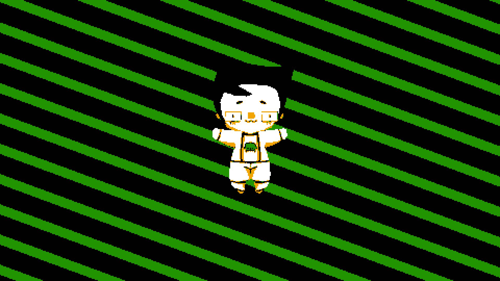
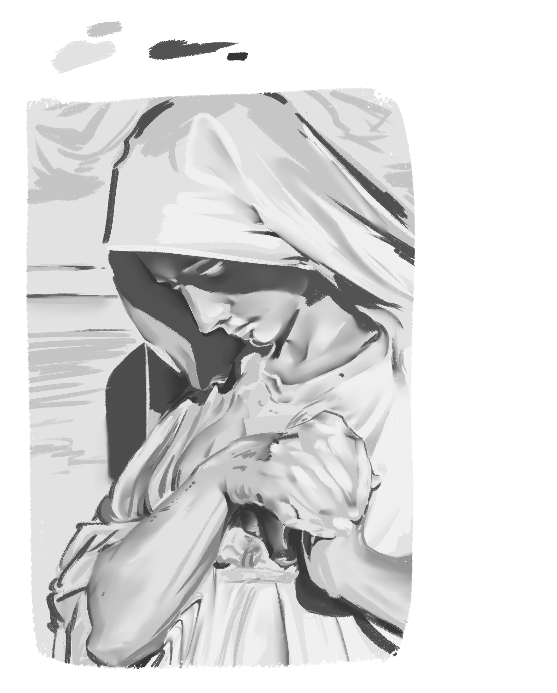
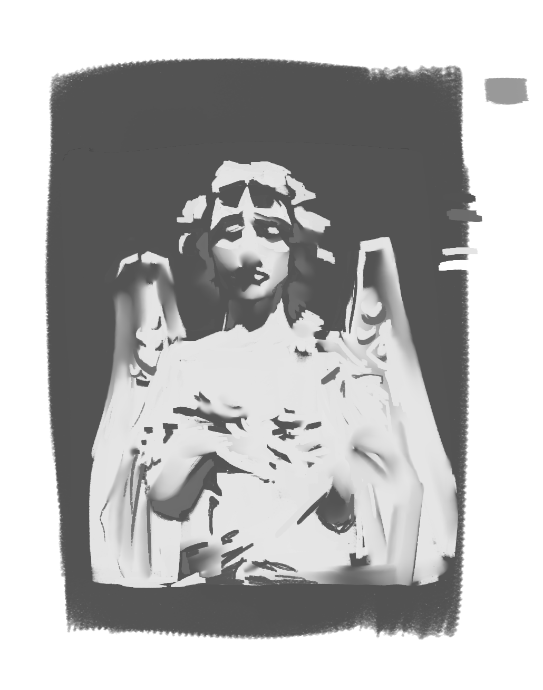
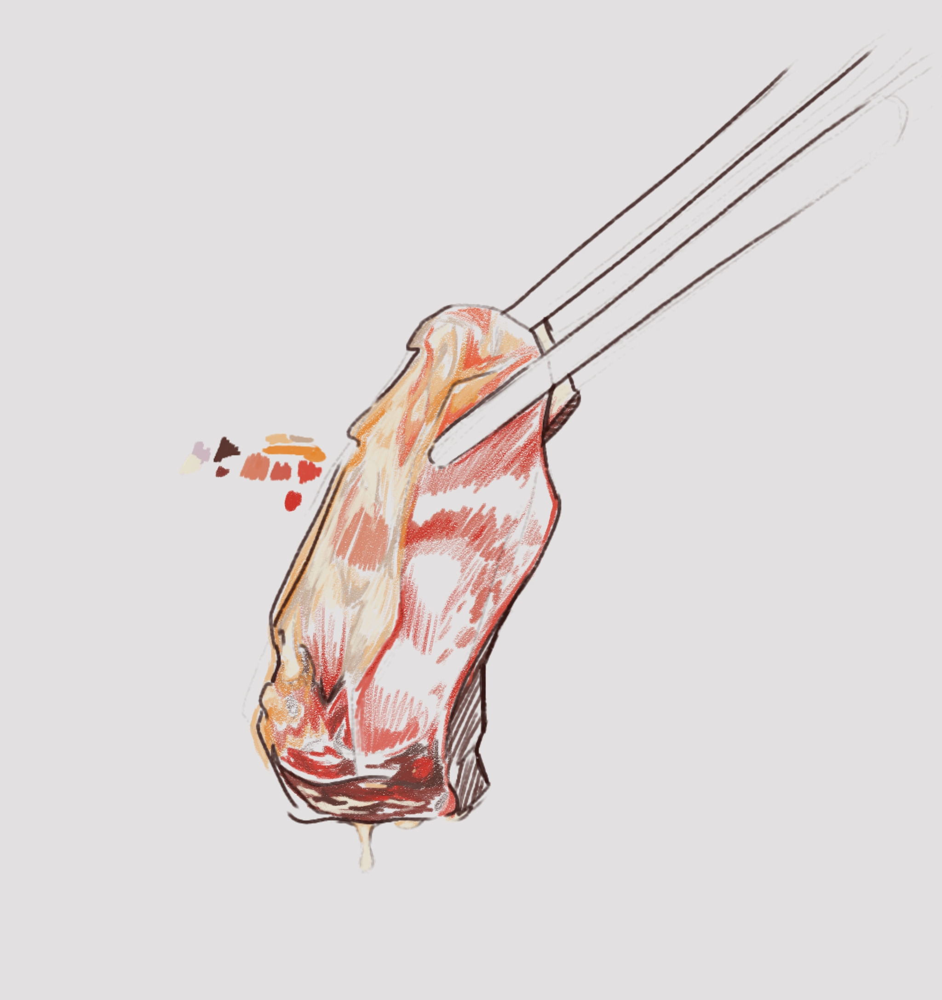
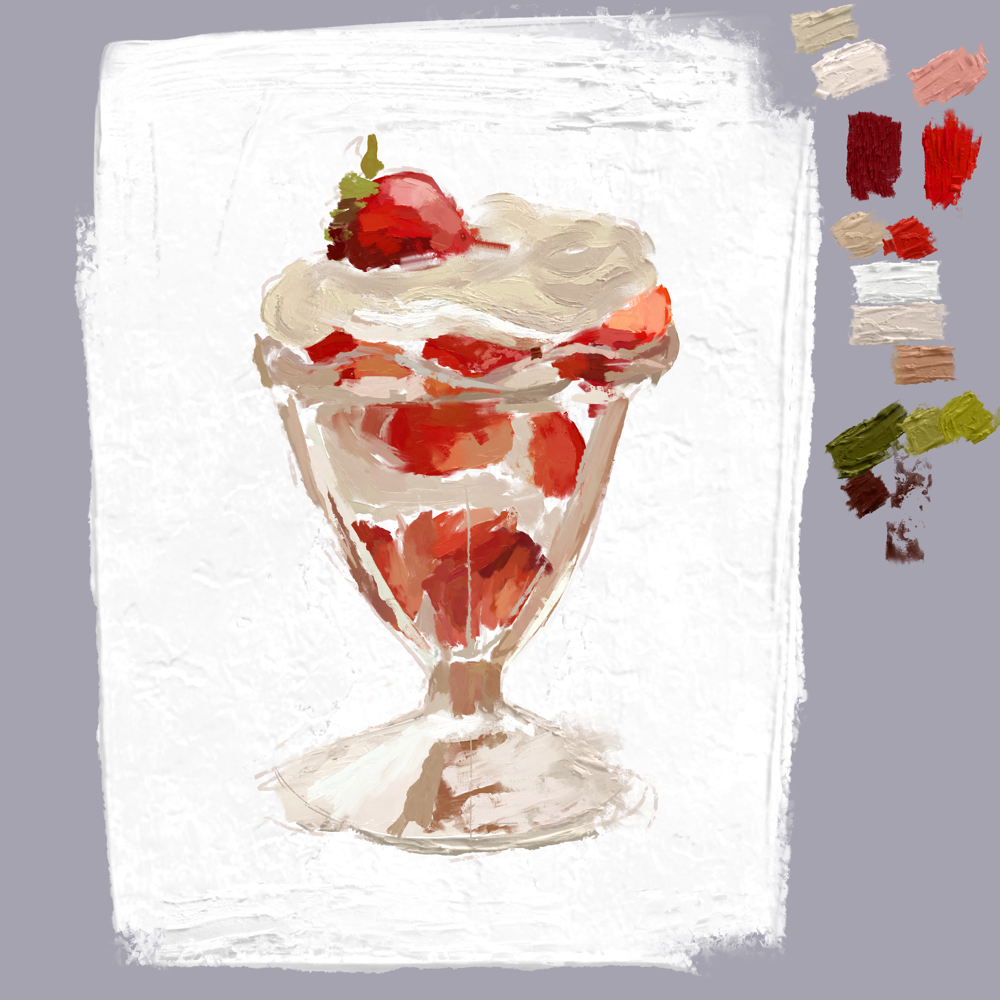

I mostly do digital art, but I'm also experienced in animation (both frame-by-frame and tweening), photo and video editing, 3D sculpting, CAD, vector art, pixel art, and traditional illustration.

I've dabbled in sewing and audio editing.

I also enjoy spending time creating digital brushes that suit my preferences and workflow. My current favourite brush is a tilt-sensitive rectangular brush that places colour when the pen is upright, but blends at when the pen is used at an angle. You can see the results showcased in [Statue Studies](#statue-studies), which is made only using that brush.

I also made the "colour-jitter roller" brush used in [meenah.png](meenah.png), which I made after realizing that I wasn't using enough colour variation in my art.

## My Personal Gallery
Here is an assorted collection of the art that I've created.

### 3D Stuff
More stuff coming soon, but in the meantime, this low-poly animation is made in Blender (including modeling, painting, UV unwrapping, animation, compositing, and video editing). The spinning effects in the background look like 2D, but they're actually curves animated in 3D, but rendered flat!

(Click to load at better speed if it is lagging in the preview)

### Statue Studies

  
  

### Food Paintings
I like to paint draw and paint pictures of food.

  
  

### Digital "Impasto" Painting
Digital art that looks like real paint

  
  

### Miscellaneous
Everything from character art, custom brushes, to ballpoint pen!

  
  
   
  
  

### Graphic Design
Coming soon!

## Questions

### "What programs do you use?"

- Krita for digital art and animation
- Inkscape for vector art and graphic design
- Asesprite* for pixel art
- Blender for 3D and video editing
- Audacity for audio manipulation
- And whatever I can get my hands on for traditional art (usually pencil and ballpoint pen)

TODO: elaborate later

### "What brushes do you use?" (digital art)

### "Can I have your brushes?"

### "What can I do with your art?"
You can do whatever you want with it. If you do something cool with my art, feel free to show me.

### "Okay sure but what license is that?"
[CC0](https://creativecommons.org/publicdomain/zero/1.0/), Public Domain. I own my art just as much as you do.
